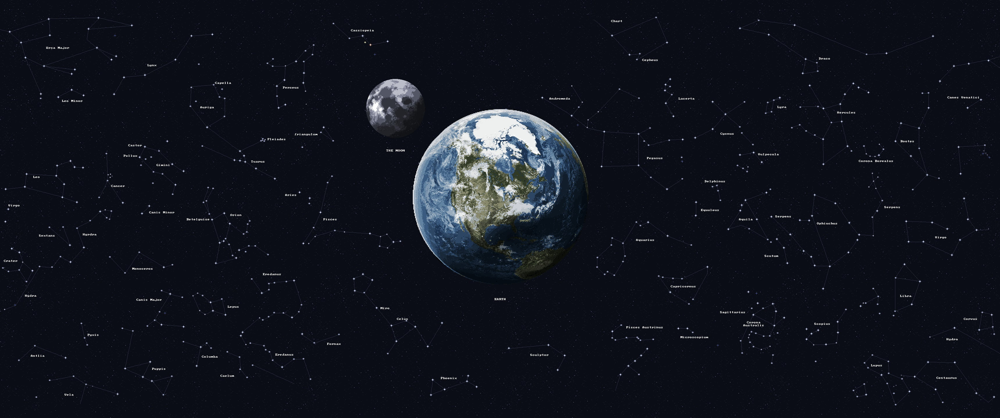

<h1 align="center">Hi , I'm Nakhalan Atqiya Arifin Putra</h1>

  
    
  
  
  
  

  

   &nbsp;
    
   &nbsp;&#10022; Just call me **Khalan**

   &nbsp;&#10022; Currently learning about basic web programming

   &nbsp;&#10022; Have good understanding of Web Development

   &nbsp;&#10022; My current goals are to become a Full-stack Web Developer, and build my own Studio Game
   
   &nbsp;&#10022; Let's talk about Web development, Game Developer, Anime stuff, and Music !!!
   
  

<h2 align="center"> <b>Technology Stack</b></h2>
 

<table>
  <tr>
    <td valign="top" width="50%">
      <h4>Programming Languages</h4>
      

        <code></code>
        <code></code>
        <code></code>
        <code></code>
        <code></code>
        <code></code>
        <code></code>
      

      <h4>Frameworks & Libraries</h4>
      

        <code></code>
        <code></code>
        <code></code>
        <code></code>
         <code></code>
      

      <h4>Game Engines</h4>
      

     <code></code>
      <code></code>
      

    </td>
    <td valign="top" width="50%">
      <h4>Database & Services</h4>
      

        <code></code>
        <code></code>
        <code></code>
        <code></code>
        <code></code>
        <code></code>
      

      <h4>Tools & Platforms</h4>
      

        <code></code>
        <code></code>
        <code></code>
        <code></code>
        <code></code>
      

      <h4>System Operation</h4>
      

        <code></code>
      

    </td>
  </tr>
</table>

    
   <h2 align="center"> &nbsp;<b>GitHub Analytics</b></h2>

   
  

  
  

 

  

<picture>
  <source media="(prefers-color-scheme: dark)" srcset="https://raw.githubusercontent.com/NakhalanAtqiyaAP/NakhalanAtqiyaAP/output/github-snake-dark.svg" />
  <source media="(prefers-color-scheme: light)" srcset="https://raw.githubusercontent.com/NakhalanAtqiyaAP/NakhalanAtqiyaAP/output/github-snake.svg" />
  
</picture>

<h2></h2>
     

